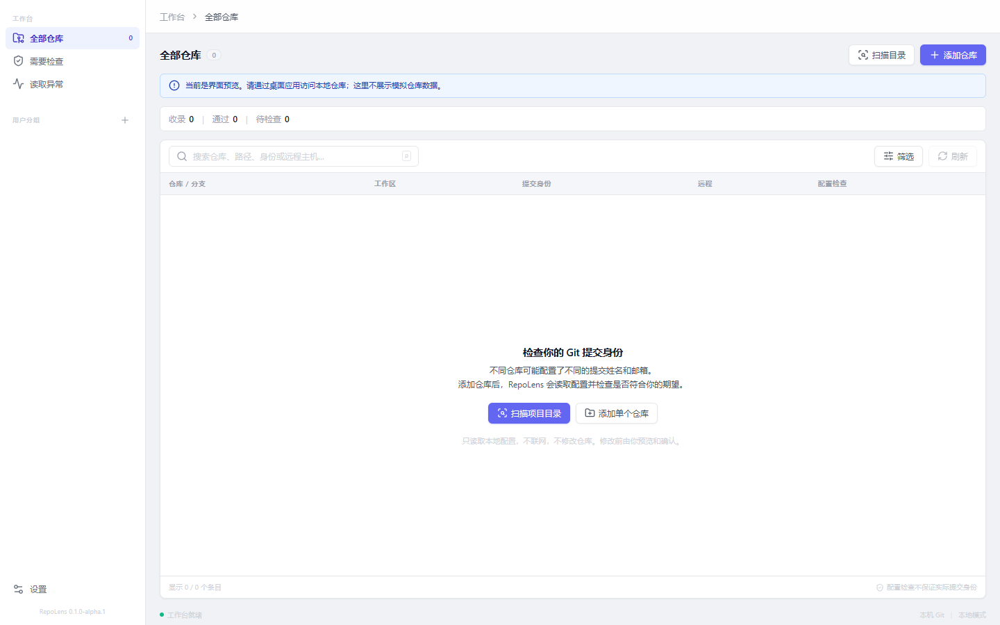

# RepoLens

**简体中文** | [English](README.en.md)

本地多 Git 仓库的提交身份检查工作台。集中查看各个仓库的姓名、邮箱和配置来源，按条目检查身份规则，并在预览确认后安全修改仓库级配置。

当前版本：`0.1.0-alpha.1`，内部验证阶段。应用界面目前为简体中文、浅色主题；英文 README 不代表应用已支持英文界面。



上图为当前浏览器布局预览，不含模拟仓库数据。真实仓库读取、扫描和保存需要运行桌面应用。早期内部构建的 [桌面工作台](docs/screenshots/workspace.png) 与 [修改预览](docs/screenshots/preview.png) 截图留作流程参考，布局可能与当前版本不同。

## 能做什么

- **发现与管理仓库**：添加单个仓库，或扫描目录后勾选收录；支持普通仓库、bare、linked worktree 和已初始化子模块。扫描可设置深度与排除项，停止或扫描异常时保留已发现结果。
- **集中查看状态**：查看 HEAD、分支、工作区、最近提交、上游及远程信息，支持分组、搜索和筛选。紧凑统计栏显示收录、通过和待检查数量，选中条目后在侧栏查看详情。
- **检查提交身份**：分别读取 `user`、`author`、`committer` 的姓名和邮箱及配置来源；每个条目可设置期望姓名、邮箱及允许域名。区分读取失败、确认未配置和显式空值，不把未知结果当作检查通过。
- **预览后修改**：仅编辑或移除仓库 `local` 范围的 `user.name`、`user.email`。确认前展示差异、覆盖提示和已知共享影响；配置或条件 include 声明变化后，旧预览会失效。写入后重新读取验证。
- **查看认证配置**：展示远程地址、HTTPS 凭据助手及 SSH 静态配置元数据。地址秘密在后端脱敏；配置存在不代表认证成功。
- **界面与操作**：统一样式变量、紧凑布局、首次使用引导、状态与配置作用域提示，以及仓库列表的上下方向键选择和 `Esc` 关闭详情。

## 使用桌面应用

目前仅提供本地内部构建，尚无正式发布安装包。Windows 构建后可直接运行 `src-tauri/target/release/repolens.exe`，或使用 `src-tauri/target/release/bundle/nsis/` 中的安装包。运行需要本机 Git 2.46+ 和 WebView2 Runtime，当前安装包未签名。

1. 添加单个仓库，或扫描项目目录后勾选收录。默认扫描深度为 3，扫描不会自动收录。
2. 选中条目查看概览、提交身份及认证配置，在“条目与规则”中设置期望身份。
3. 修改基础身份或移除 local 配置，核对预览后确认保存，再检查读回结果。

规则属于单个条目，分组不继承规则。“未设置规则”本身不会计入待检查；身份缺失仍会提醒。worktree 的 local 配置可能共享，预览会列出已收录的关联条目。

默认离线。应用不执行 commit、fetch、pull、push 等日常 Git 操作；认证概览不获取密码或 Token，不执行凭据助手、SSH 代理命令，也不打开私钥。当前不提供全局身份、author/committer 或 worktree 专属身份编辑、认证连接测试、深色主题及自动更新。

移除条目只移除应用中的收录记录，不删除磁盘上的仓库。SQLite 保存收录、分组、规则和 Git 可执行路径，应用数据目录可在设置中查看。备份与卸载说明见 [实施记录](docs/IMPLEMENTATION.md)。

## 本地开发

需要 Node.js 22.12+、Rust 工具链、本机 Git 2.46+ 和 [Tauri 2 平台构建依赖](https://v2.tauri.app/start/prerequisites/)。项目 CI 使用 Rust 1.99.1，Cargo 声明的 Rust 支持下限为 1.99；已验证环境为 Node 24.18.0、Rust 1.99.1、Git 2.55.0.windows.1。

```sh
npm ci
npm run desktop:dev
```

如当前 Windows 工作区已有 `.tools/` 中的本地 Rust/MSVC/SDK，可先在 PowerShell 执行 `. ./scripts/dev-env.ps1`。这些工具不随仓库分发；其他机器应安装标准平台工具链。

| 目的           | 命令                                      | 说明                                                              |
| -------------- | ----------------------------------------- | ----------------------------------------------------------------- |
| 浏览器布局预览 | `npm run dev`                             | 打开 `http://127.0.0.1:1420/`，修改后通常自动更新；不访问本机仓库 |
| 桌面开发调试   | `npm run desktop:dev`                     | 带 Rust 后端，可测试读取、扫描和保存                              |
| 前端检查与测试 | `npm run check`                           | TypeScript 检查和 Vitest 测试                                     |
| 前端生产构建   | `npm run build`                           | 生成 `dist/`，不启动服务，也不更新已安装的桌面程序                |
| Windows 安装包 | `npm run desktop:build -- --bundles nsis` | 重新打包前端与桌面程序，产物位于 `src-tauri/target/release/`      |

### 端口占用或修改后没有变化

- 提示 `Port 1420 is already in use`：已有进程占用开发端口。若已运行本项目服务，直接访问该地址；需要重启时，在原服务终端按 `Ctrl+C` 后重新启动。
- 浏览器未更新：先保存文件，确认访问的是 `http://127.0.0.1:1420/`，再按 `Ctrl+F5` 强制刷新，并检查开发终端是否报错。
- 已安装或直接运行的 Release 程序未更新：它使用打包时的前端。使用 `npm run desktop:dev` 调试，或重新构建后启动新程序；浏览器刷新不能更新已打包程序。
- 浏览器看不到仓库列表或详情效果：预览不提供模拟业务数据，请在桌面开发模式添加真实仓库后查看。

## 验证

```sh
npm run check
npm run build
cargo fmt --manifest-path src-tauri/Cargo.toml -- --check
cargo test --manifest-path src-tauri/Cargo.toml --locked
cargo clippy --manifest-path src-tauri/Cargo.toml --all-targets --features desktop --locked -- -D warnings
```

Windows 实际桌面回归：先构建 Release 程序，再在交互式 Windows 会话运行 `node scripts/desktop-smoke.mjs` 或 `scripts/desktop-smoke.ps1`。脚本使用隔离 Git 配置、样例仓库和独立 WebView2 测试目录，检查真实 IPC 流程，结束时关闭测试进程并移除样例收录。不要并行运行多个此脚本。

审查修复基线记录了 48 项 Rust 测试、10 项前端测试及 10 段桌面流程；后续界面改动不自动继承该轮桌面验收结论。Windows 已有内部构建验证；macOS、Linux 及独立安装卸载仍待验收，CI 配置存在不等于跨平台验证通过。具体范围见 [验证记录](docs/VERIFICATION.md) 和 [修复记录](docs/REVIEW-FIXES.md)。

## 项目结构与文档

| 路径                                          | 内容                                                              |
| --------------------------------------------- | ----------------------------------------------------------------- |
| `src/App.tsx`                                 | React 工作台与交互                                                |
| `src/tokens.css` / `src/styles.css`           | 统一样式变量、组件样式与响应式布局                                |
| `src/api.ts` / `src/types.ts` / `src/view.ts` | 桌面 IPC、类型与展示规则                                          |
| `src-tauri/src/`                              | Git 适配、扫描、身份检查、认证元数据、预览写入、SQLite 和桌面命令 |
| `src-tauri/tests/core.rs`                     | 隔离仓库集成测试，不修改个人 Git 配置                             |
| `src-tauri/examples/benchmark.rs`             | 10 / 100 / 500 条目本地性能样例                                   |
| `docs/`                                       | 设计、实施、验证与修复记录                                        |

- [设计文档](docs/design-v1.0.0.md)
- [实施记录](docs/IMPLEMENTATION.md)
- [产品说明](PRODUCT.md)（英文）

## 许可

尚未选择开源许可证；当前文件不构成开源授权。安装包仅供内部验证，尚未正式发布。
