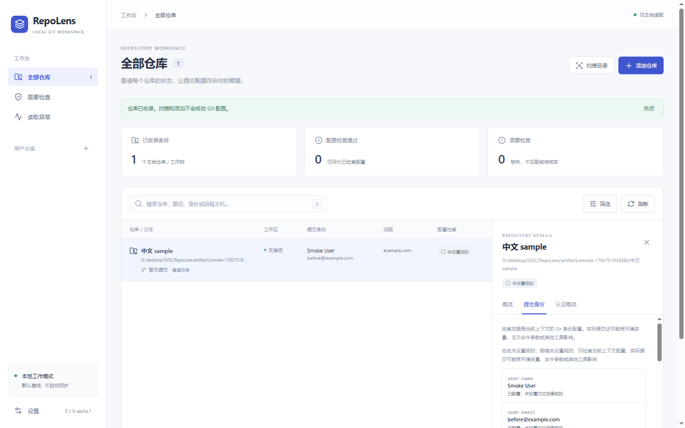

# RepoLens

本地多 Git 仓库工作台：集中查看状态、核对提交身份、追踪配置来源，并在预览确认后修改仓库的基础提交身份。第一版实现依据 [设计文档](docs/design-v1.0.0.md)，开发节点和验收证据见 [实施记录](docs/IMPLEMENTATION.md)。

当前为 `0.1.0-alpha.1` 内部验证版，简体中文、浅色界面。

实际桌面界面（隔离样例仓库）：



配置预览界面见 [截图](docs/screenshots/preview.png)。

## 使用

Windows 构建产物在 `src-tauri/target/release/`：`repolens.exe` 可直接运行，NSIS 安装包位于 `bundle/nsis/`。需要本机 Git 2.46+ 和 WebView2 Runtime。安装程序未签名。

1. 添加单个仓库，或扫描目录后勾选收录。扫描默认深度 3，停止后保留已发现结果。
2. 选中仓库查看概览、提交身份及认证配置；在“条目与规则”中为该条目设定期望姓名、邮箱或域名。
3. 编辑基础身份，检查已知覆盖项，生成变更预览，再确认写入。移除 local 配置有独立入口。
4. 保存后检查实际结果。worktree 的 local 配置可能共享，预览会列出已收录的关联条目。

规则属于单个条目，分组不继承规则。“未设置规则”不会单独计入需要检查；身份缺失仍会提醒。作者、提交者覆盖分别核对，不能用基础身份正常掩盖覆盖异常。

默认离线。刷新和扫描不会 fetch、pull、push；认证概览不获取密码或 Token，不执行凭据助手、SSH 代理命令，不打开私钥。显示“已配置”不代表认证成功。HTTPS 候选用户名原值保守隐藏，避免将 Token 当作用户名展示。

移除条目只删除应用收录记录，不删除仓库或规则以外的 Git 配置。应用数据位于系统的 RepoLens 应用数据目录，可在设置查看；SQLite 仅保存收录、分组、规则和 Git 路径。卸载后的应用数据保留策略及发布平台状态见实施记录。

## 开发

依赖 Node 22.12+、Rust 1.99.1、Git 2.46+ 和 Tauri 2 平台构建依赖。此次实际环境为 Node 24.18.0、Rust 1.99.1、Git 2.55.0.windows.1。锁文件已生成并保留在工作区。

```powershell
npm ci
npm run desktop:dev
```

本次工作区已经准备了忽略跟踪的本地 Rust/MSVC/SDK 工具，可在 Windows PowerShell 中先执行 `. ./scripts/dev-env.ps1`。其他机器使用标准平台工具链，无需此脚本。

```powershell
npm run check
npm run build
cargo test --manifest-path src-tauri/Cargo.toml --locked
cargo clippy --manifest-path src-tauri/Cargo.toml --all-targets --features desktop --locked -- -D warnings
npm run desktop:build -- --bundles nsis
```

真实 Windows 桌面回归：在交互式 Windows 会话运行 `node scripts/desktop-smoke.mjs`（或 `scripts/desktop-smoke.ps1`）。脚本启动本项目 Release 程序的独立 WebView2 测试目录，在本地调试端口检查真实 IPC 流程，结束时关闭测试进程并移除样例收录；不接管前台键鼠。请先完成 Release 构建，勿并行运行多个此脚本。

`npm run dev` 仅提供浏览器布局预览；仓库操作需要桌面宿主，不提供模拟仓库数据。平台依赖安装说明参考 [Tauri 官方文档](https://v2.tauri.app/start/prerequisites/)。

## 结构

- `src/`：React 工作台、IPC 类型与展示规则。
- `src-tauri/src/`：Git 进程适配、扫描、身份检查、认证元数据、预览写入、SQLite 和桌面命令。
- `src-tauri/tests/core.rs`：隔离仓库集成测试，不修改个人 Git 配置。
- `src-tauri/examples/benchmark.rs`：10／100／500 条目本地性能样例。
- `docs/`：设计快照、实现追踪与验证说明。

尚未选择开源许可证；当前文件不构成开源授权。源码提交与推送状态以仓库历史为准；安装包仅用于内部验证，尚未正式发布。
