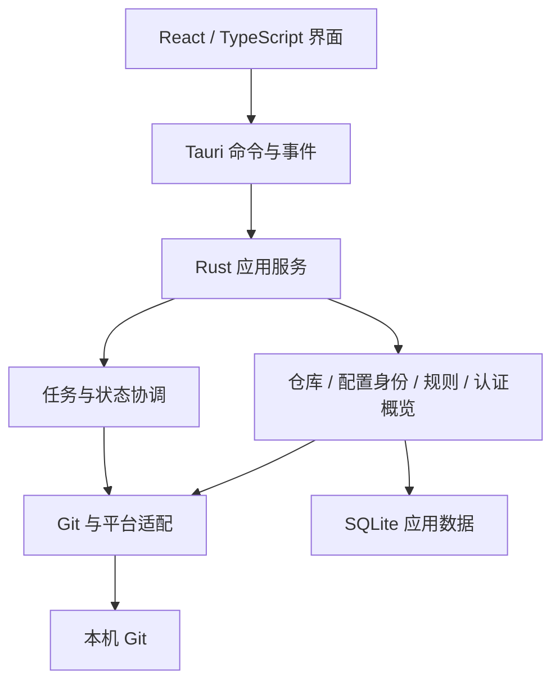

# RepoLens 开发设计文档

> 文档版本：v1.0.0（评审修订稿）
>
> 修订日期：2026-10-23
>
> 当前阶段：需求与架构设计，尚未开始功能开发
>
> 目标平台：Windows、macOS、Linux
>
> 源码仓库：[zyf123489/RepoLens](https://github.com/zyf123489/RepoLens)

## 1. 文档约定与版本

本文作为 RepoLens 第一版需求、交互、架构和验收的设计依据。当前版本根据评审意见收紧能力承诺，并补充可执行的规则。

- **必须**：本修订稿中的功能要求或安全边界。
- **建议**：实现方向，可在验证后调整，不等同于已实现。
- **待确定**：尚未形成结论，不能作为已经承诺的发布能力。

文档版本与软件版本分开：`v1.0.0` 是这份设计文档的版本，与 Obsidian 文件名 `RepoLens设计文档_v1.0.0.md` 保持一致；软件第一版的产品版本号尚未确定。本文版本号不表示软件已经构建、验收或发布。本轮是在该设计文档上的评审修订，修改日期与修订摘要用于记录内容变化。

本次仅整理和修订文档，不包含功能代码、Git 提交、推送或正式发布。

### 1.1 本轮修订摘要

| 评审问题 | 本轮收敛规则 |
| --- | --- |
| “身份匹配”含义过宽 | 分开检查基础配置、作者配置和提交者配置；总结果限定为配置检查，不保证具体提交身份 |
| worktree 编辑承诺不清 | 第一版必需编辑能力限定为 local；已知覆盖与共享影响在确认前说明 |
| “认证管理”名称过宽 | 统一为“认证配置概览”，不承诺账号识别、登录切换或凭据编辑 |
| 身份规则及汇总缺失 | 第一版采用条目独立规则，字段分别检查、约束之间全部满足，统一总状态优先级 |
| 包含关系展示深度不明 | 正确应用 include/includeIf，并展示来源与覆盖顺序；完整包含链不作为第一版必需验收项 |
| 秘密读取表述冲突 | 禁止主动查询或提取秘密；必要配置夹带秘密时，在对外传递和记录前脱敏 |
| 扫描、分组与局部失败不清 | 扫描结果经选择后收录；独立工作树条目、单一用户分组、模块独立加载和错误展示 |

本轮补充的交互和规则属于修订方案；后续如需调整，应同步更新规则、示例和验收用例。

## 2. 产品定位与交付目标

### 2.1 软件解决什么问题

RepoLens 是面向多仓库、多身份场景的本地 Git 管理桌面软件。

用户在一台电脑上有个人项目、工作项目和不同平台的仓库，需要看清：

1. 仓库在哪里，现在是什么状态。
2. 当前上下文中配置了什么提交姓名与邮箱。
3. 配置来自哪里，是否符合自己的期望。
4. 哪些覆盖项可能影响作者或提交者配置。
5. 如何安全修改仓库级姓名、邮箱并检查结果。
6. 每个远程端点配置了什么认证方式，以及哪些信息仍未知。

第一版的核心流程为：

> 添加或扫描 → 选择收录 → 查看仓库与配置 → 检查期望 → 预览修改 → 确认保存 → 重新读取验证。

### 2.2 第一版与长期方向

第一版是“多仓库状态与提交身份检查工作台”，包含提交身份编辑与认证配置概览。

第一版不提供提交、暂存、fetch、pull、push、合并、变基、重置等日常或高级 Git 操作。

长期以 TortoiseGit 为能力参照，逐步发展为完整 Git 可视化客户端。架构和工作区布局需要支持后续扩展，第一版界面仅展示已实现入口。

### 2.3 最终交付

目标是在 Windows、macOS、Linux 上提供可安装、可运行的正式发布版本，并提供源码、构建说明、使用说明和对应版本的发布产物。

每个平台需要分别构建与验证。三平台支持是产品目标，最低系统版本、CPU 架构、最低 Git 版本等仍需形成具体发布矩阵，才能成为可执行的发布承诺。

## 3. 已确定的技术与设计方向

| 部分 | 决策 | 职责 |
| --- | --- | --- |
| 核心逻辑 | Rust | 仓库扫描、配置解析、检查、任务和写入调度 |
| 桌面框架 | Tauri 2 | 窗口、菜单、系统集成、界面与核心通信 |
| 网页界面 | React + TypeScript | 表格、详情、表单及后续 Git 工作区 |
| Git 引擎 | 本机 Git | Git 配置和仓库状态读取、经确认的配置写入 |
| 本地数据 | SQLite | 收录条目、分组、规则、偏好等应用数据 |
| 视觉参考 | Beacon | 正式、克制、规整的桌面工作台 |
| 默认行为 | 只读、离线 | 不自动联网，不隐含同步，不自动上传 |

Tauri 使用平台 WebView；Rust 核心不意味着整个应用没有界面运行开销。轻量目标需要通过真实构建和测量验证。

## 4. 核心概念与能力边界

### 4.1 三类身份

| 概念 | 含义 | 不代表什么 |
| --- | --- | --- |
| Git 配置身份 | `user.*`、适用的 `author.*`、`committer.*` 等当前配置 | 不保证任意一次实际提交的最终身份 |
| 实际提交身份 | 某次提交最终写入的 author、committer | 不能只凭基础配置预知 |
| 远程认证账号 | 远程服务最终识别出的访问者 | 不等于提交姓名、邮箱或远程仓库所有者 |

实际提交可能受到身份配置、环境变量、本次命令参数以及其他工具执行上下文的影响。软件只解释当前读取上下文，不预知其他应用未来的行为。

界面禁止使用含义不明的“当前账号”或笼统的“身份正常”。`user.name` 统一称为“提交姓名”，不称为登录用户名。

### 4.2 工作树条目与共享仓库

- 普通工作区和 linked worktree 都以独立的管理条目展示。
- 不同条目可以共享同一 Git 公共目录。
- 裸仓库作为独立条目，工作区统计标记“不适用”。
- 已初始化子模块作为独立仓库条目，同时标注其子模块关系。

路径、条目 ID 和共享 Git 目录分别承担路径定位、应用数据归属和资源协调职责，不能混为一个去重键。

### 4.3 已配置与已验证

配置存在不等于认证成功；认证成功不等于具有目标仓库写权限；公开仓库可读也不能证明已登录某个账号。

界面分别展示配置读取状态与连接验证状态，无法确定的内容显示“未知”。

## 5. 第一版范围

### 5.1 必需交付

1. 添加单个仓库和指定目录批量扫描。
2. 扫描深度、排除目录、进度、停止、结果选择和收录。
3. 普通仓库、worktree、裸仓库识别，以及已初始化子模块标注。
4. 仓库搜索、筛选、刷新、分组和移出列表。
5. 状态、HEAD、远程、最近提交、基于本地引用的领先/落后数量。
6. 基础配置身份及作者、提交者覆盖配置读取。
7. 配置来源、作用域、覆盖顺序，以及 include/includeIf 的正确应用。
8. 条目独立的期望身份与邮箱规则、明确的检查汇总。
9. 按远程端点展示认证配置概览。
10. local 作用域的 `user.name`、`user.email` 修改与直接配置移除。
11. 变更预览、明确确认、重新读取及结果验证。
12. 已声明支持组合的构建、安装和关键流程验收。

### 5.2 不作为第一版必需功能

- 全局配置编辑：如提供，必须独立入口和独立确认。
- worktree 专属配置编辑：不属于必需范围，不自动启用相关扩展。
- `author.*`、`committer.*` 编辑：第一版读取与检查，但不提供修改入口。
- 连接测试：可选；如提供，必须符合联网授权和隐私要求。
- 完整 include/includeIf 包含链、未命中条件诊断：后续增强项。
- 认证账号切换、密码或 Token 管理、SSH 配置编辑：不提供。
- 数据导出：未确定提供；以后提供时遵守相同脱敏要求。

### 5.3 操作边界

第一版不修改工作区文件、索引、分支和提交历史；仓库内的写入仅限本文件规定且经用户确认的身份配置变更。不执行删除仓库、重置、强制推送、worktree remove/prune 等操作。

“移出列表”只移除 RepoLens 收录数据，不删除本地仓库。软件分组不移动磁盘目录。

## 6. 仓库发现与扫描收录

### 6.1 添加单个仓库

用户选择路径后，通过 Git 确认仓库及工作区上下文，不只检查是否有 `.git` 目录。

允许选择仓库内部目录；解析出实际工作区根路径并展示确认。裸仓库展示其仓库路径。

区分有效仓库、无仓库、无权限、Git 不可用、仓库损坏等结果。不能把读取失败解释为“不是仓库”。

### 6.2 扫描规则

本轮采用以下默认行为：

- 用户明确选择根目录，根目录为深度 0；最大深度默认 3，可在开始前调整。
- 排除项分为“目录名”和“相对路径”：前者按完整目录名匹配，后者从扫描根目录按路径段匹配并排除整个子树，不把 `foo` 匹配成 `foobar`。第一版不提供通配符或正则表达式。
- 路径输入在界面中使用统一分隔符，并按目标文件系统的大小写语义比较；不通过对所有平台路径统一转小写来去重。排除规则同时约束嵌套仓库和子模块扫描。
- `.git` 等 Git 管理目录不作为普通目录递归扫描；识别出裸仓库后不遍历其内部对象目录。
- 建议预置 `node_modules`、`target`、`dist`、`build`、`.venv`、`venv`、`.cache` 排除项，启动前可查看和修改。
- 默认不递归跟随目录符号链接或 junction，不自动跳到扫描边界之外。
- 发现普通工作区后，仍按深度和排除规则扫描其普通子目录，以发现嵌套仓库。
- 已初始化子模块单独列出并标注关联关系；未初始化子模块不执行初始化或克隆，也不计作可管理本地仓库。
- 无权限目录记录问题后继续其他目录；支持取消，并释放后台任务。

这些默认值是实现基线，后续可根据实测调整，但改变时必须同步设置界面和验收用例。

### 6.3 结果如何进入列表

扫描发现的条目先进入临时结果列表，不自动加入正式仓库列表。

用户可在扫描完成或停止后选择结果，点击“添加所选仓库”收录。已收录条目标记“已添加”，不能重复添加。

停止扫描保留本次已发现的临时结果，用户仍可选择收录；关闭结果面板或退出应用后，不保证恢复尚未收录的临时结果。已正式收录的条目保持不变。

### 6.4 去重与路径变化

同一工作区根路径的重复发现合并。不同 worktree 即使共享公共 Git 目录，也作为不同条目。

路径失效时保留记录并显示不可访问，不自动删除。路径重新关联必须由用户确认，避免误把旧规则赋给其他仓库。

## 7. 搜索、分组与导航

### 7.1 搜索与筛选

搜索覆盖名称、别名、路径、配置姓名、邮箱和远程主机。远程地址必须先脱敏，搜索索引不保存原始秘密。

筛选覆盖仓库类型、工作区状态、配置检查状态和远程主机或平台。

### 7.2 分组与规则归属

第一版一个条目最多属于一个用户分组，也可以不分组。“全部仓库”“需要检查”等系统视图不计作用户分组。

分组只用于整理，不携带或继承身份规则。每个条目的期望姓名、邮箱和域名规则独立保存。

同一 Git 仓库的不同 worktree 可以属于不同分组、拥有独立期望身份。共享 local 配置修改后，应重新检查相关已收录 worktree。

### 7.3 “需要检查”的范围

包含以下任一情况：

- 基础姓名或邮箱缺失。
- 已检查的身份配置不符合期望或规则。
- 身份覆盖项需要人工核实。
- 身份配置读取失败或不完整。
- 仓库路径失效或仓库整体不可访问。

仅“未设置规则”不进入“需要检查”；但未设置规则且邮箱缺失时，仍因缺失进入。认证账号未知、未测试以及仅工作区有修改，不自动认定身份有问题。

其他模块错误保留独立问题标记和“读取异常”筛选，不强行合并成身份结论。

## 8. 仓库信息与局部读取

### 8.1 展示字段

| 类别 | 字段 | 特殊情况 |
| --- | --- | --- |
| 标识 | 名称、别名、路径、仓库类型 | 别名不改磁盘名称 |
| HEAD | 分支、detached HEAD、空仓库状态 | 未产生提交不显示伪造的最近提交 |
| 工作区 | 已暂存、未暂存、未跟踪文件数 | 裸仓库不适用 |
| 最近提交 | 时间、摘要、作者和邮箱 | 暂无提交单独表达 |
| 远程 | remote 名称、获取/推送地址、协议、主机 | 支持多个端点 |
| 上游 | 上游及基于本地引用的领先/落后数 | 无上游、引用缺失、失败分别显示 |

同一文件可以同时计入已暂存和未暂存类别，不把三类数量相加解释为唯一文件总数。

领先/落后信息旁固定说明：

> 根据本地引用计算，未连接远程更新，可能与远端当前状态不同。

刷新只重新读取本地信息，不隐含 fetch。

### 8.2 局部读取失败

仓库基本信息、工作区、历史、远程、身份、认证等模块独立拥有加载状态和结果。

状态至少包含：读取中、成功、暂无数据、不适用、部分成功、失败，以及有时间戳的旧缓存。

例如工作区读取失败但身份读取成功时，继续显示身份及其检查结果，同时在工作区区域显示错误。不能清空所有面板，也不能显示“零修改”。

“配置检查通过”只评价身份模块，不代表整个仓库无错误。工作区问题不能伪装成身份解析错误。

### 8.3 远程平台字段

远程协议、主机、平台分别建模。平台识别只是已知主机映射，不等于登录账号识别。

- 已知公共服务可显示平台名称与实际主机。
- 多远程跨平台时，列表显示“多个平台/主机”，详情逐端点展开，不擅自选一个代表全部。
- 私有服务无法识别时显示主机，不猜测具体产品。
- SSH 别名未安全解析时显示别名和“平台未知”；安全解析后仍保留别名与解析主机的区别。
- 本地路径等非托管平台端点显示对应类型。

## 9. 提交身份与来源展示

### 9.1 必读取的配置

| 类别 | 配置键 | 界面含义 |
| --- | --- | --- |
| 基础配置 | `user.name`、`user.email` | 通用的配置姓名与邮箱 |
| 作者覆盖 | `author.name`、`author.email` | 当前可读取的作者配置覆盖 |
| 提交者覆盖 | `committer.name`、`committer.email` | 当前可读取的提交者配置覆盖 |

每个键分别展示生效值、来源、作用域和覆盖项。值缺失、显式空值、读取失败必须区分。

派生的“配置作者”“配置提交者”按 Git 配置语义解释：对应专属项未配置时使用基础值；显式无效值不擅自当作缺失回退。它们始终标注为配置视角，不叫“下一次提交的最终作者”。

第一版编辑范围仅为 `user.name`、`user.email`。检测到其他覆盖项不意味着可以通过此编辑入口修正它们。

### 9.2 来源与包含关系的验收深度

第一版必须做到：

1. 由目标仓库上下文中的本机 Git 正确处理适用的 include/includeIf。
2. 展示实际读到的相关键及其作用域、来源文件或来源类型。
3. 展示相关键的覆盖顺序及最终生效值。
4. 姓名和邮箱分别解释来源。
5. 来源无法读取或解析时说明限制，不猜测。

第一版不承诺展示完整的“父文件 → 条件 → 子文件”包含链，也不承诺解释所有未命中的条件。不能仅凭最终来源路径反推并展示未经验证的关系图。

如果只知道最终来源，文案为“来源文件”，并提示“未提供完整包含链”。缺少包含链本身不使正确读取的配置检查失败。

来源、作用域和覆盖顺序应优先使用 Git 的程序化输出。对于指定作用域的查询，要明确 include 行为，不能依赖不同查询模式下不一致的默认值。

### 9.3 上下文与说明

展示所选 Git、目标路径和读取时间。分支、路径、远程配置等上下文变化后重新读取，不缓存一个永久身份结论。

固定说明：

> 检查范围是当前上下文的 Git 身份配置。实际提交还可能受环境变量、本次命令参数或其他工具的执行环境影响。

第一版不要求推演所有环境变量和未来命令参数。未检查部分明确说明，不展示完整进程环境。若提供当前进程覆盖项诊断，仅查询身份相关的白名单项，并将其作为独立提示。

最近提交中的作者属于历史信息，不与当前配置混合。

## 10. 身份规则与汇总算法

### 10.1 规则归属与类型

规则只归属于当前管理条目，不继承分组规则，不隐式复用其他 worktree 的规则。

第一版支持三个可独立启用的约束：

- 期望姓名：一个精确值。
- 期望邮箱：一个精确值。
- 允许的邮箱域名：一个或多个完整域名。

姓名与精确邮箱按保存后的字符串精确比较，不静默改变大小写或内容。域名匹配忽略域名大小写，默认只匹配完整域名，不自动匹配子域名。

不静默修剪用户输入；如建议规范化，展示规范化后的内容，由用户在保存预览中确认。

### 10.2 多规则如何组合

- 姓名与邮箱分别检查。
- 同一条目启用的不同约束必须全部满足，即 AND。
- 允许域名列表内部满足任意一个即可，即 OR。
- 同时设置精确邮箱和允许域名时，精确邮箱也必须属于允许范围。
- 规则互相冲突或格式无效时，禁止保存该规则，展示冲突原因；不留到仓库检查时随机选一条。
- 不支持第一版分组继承、多分组规则优先级或任意正则表达式。

邮箱格式检查不代表邮箱真实存在或可收信。

### 10.3 分项检查

基础姓名、基础邮箱分别展示：已配置且匹配、已配置但不匹配、缺失、未设置对应规则、无法检查。

没有规则也必须提示基础配置缺失。缺少基础配置不等于断言 Git 一定无法提交，因为 Git 还可能通过其他途径获得身份。

对配置作者与配置提交者：

1. 应用与基础配置相同的姓名和邮箱约束。
2. 对专属覆盖值，明确显示其来源及与基础值的关系。
3. 任一已检查的作者或提交者字段违反约束，都记录为不匹配，不能被基础配置匹配掩盖。
4. 存在与基础值不同的专属覆盖，而该字段又没有对应检查约束时，记录“覆盖待核实”。
5. 读取不完整时保留已知结果，同时标明未检查部分，不能给出完整通过结论。

例如 `user.email` 为公司邮箱，而 `author.email` 为不符合期望的个人邮箱时：基础邮箱显示匹配，作者邮箱显示不匹配，总状态必须是不匹配。

### 10.4 总状态与优先级

先收集所有原因，再按下表选择一个列表主状态；详情仍保留全部分项结果，不能因为优先级隐藏其他问题。

| 优先级 | 主状态 | 条件 |
| --- | --- | --- |
| 1 | 无法完成配置检查 | 身份读取失败或检查所需结果不完整 |
| 2 | 配置不匹配 | 任一已检查身份字段违反有效规则 |
| 3 | 基础配置缺失 | 姓名或邮箱未配置或不可作为有效基础值 |
| 4 | 覆盖待核实 | 检测到不同的作者/提交者覆盖，但缺少该字段的判断规则 |
| 5 | 未设置规则 | 没有任何期望约束，且没有更高优先级问题 |
| 6 | 配置检查通过 | 读取完整，至少设置一项约束，所有已启用约束满足，无上述问题 |

如果只设置邮箱规则，通过状态必须标注“已检查邮箱规则；姓名未设置规则”，不能使用户误以为所有字段都经过完整期望验证。

“基础配置匹配”只作为 `user.*` 的分项结果；总状态不使用“身份正常”“实际作者正确”等文案。即使配置检查通过，也保留实际提交身份可能被外部覆盖的说明。

### 10.5 示例

| 输入情形 | 结果 |
| --- | --- |
| 无规则且无邮箱 | 基础配置缺失，进入需要检查 |
| 姓名匹配，邮箱不匹配 | 配置不匹配，分别展示字段结果 |
| 基础邮箱匹配，作者邮箱不匹配 | 配置不匹配，指出作者覆盖 |
| 不同的作者姓名覆盖，未设置姓名规则 | 覆盖待核实 |
| 有完整基础配置，无规则、无待核实项 | 未设置规则，不进入需要检查 |
| 精确邮箱不在允许域名内 | 拒绝保存规则并显示冲突 |
| 状态模块失败，身份配置检查通过 | 身份结果保持通过，工作区单独显示失败 |

修改 Git 实际配置不自动改变期望规则；如提供“同时设为期望身份”，必须是用户明确选择。

## 11. 认证配置概览

### 11.1 对用户的承诺

本功能回答“配置了什么”，不保证回答“当前实际登录谁”，不提供账号切换。

文档、导航和发布说明统一使用“认证配置概览”。提交身份编辑与认证配置展示是两个独立功能。

### 11.2 按端点展示

每个 remote 的获取和推送端点分别展示协议、脱敏地址、相关配置与来源。

除 HTTPS、SSH 外，允许本地路径、file、git 等协议及未知类型。SSH 用户、仓库所有者和平台账号分别表达。

如能可靠解析 URL 重写，区分配置地址和解析地址；不能确定时显示限制，不能因地址格式推断认证成功。

### 11.3 HTTPS

展示适用的 credential helper 配置、已配置用户名及其来源。多个 helper 保留顺序及重置语义。

只读取允许的配置元数据，不为识别账号执行 helper，不调用 `git credential fill` 或其他可能返回密码、Token 的凭据获取接口。

无法可靠判断账号或凭据存在性时显示“未知”。配置用户名也不保证是最终认证账号。

### 11.4 SSH

展示地址中的 SSH 用户、主机别名，以及能安全解析出的主机名、端口、密钥路径及来源。

只处理非敏感配置元数据，不打开私钥内容。密钥路径存在不证明实际使用或认证成功。

不为展开配置自动执行 `Match exec`、代理命令等程序。无法在无副作用条件下完整解析时，显示已知部分和限制，而非构造确定结论。

### 11.5 可选连接测试

如果纳入第一版：

1. 用户主动触发，执行前明确说明会访问网络。
2. 说明目标、测试方式和结论范围。
3. 不执行 fetch、pull、push，不修改仓库引用。
4. 认证通过经验证的现有 Git/SSH 流程处理；应用不查询或返回秘密值。
5. 有超时、进度和适当的取消处理。
6. 结果包含时间与验证对象；地址或认证配置改变后旧结果失效。
7. 读取成功、SSH 身份认证成功、写权限分别解释，不能互相替代。

未提供连接测试时，统一显示“未测试”，不能凭配置显示“已认证”。

## 12. 配置编辑的承诺与流程

### 12.1 精确承诺

第一版承诺：能经确认后修改目标仓库 local 作用域中的 `user.name`、`user.email`，并验证写入及生效情况。

第一版不承诺：仅通过该入口就一定能修正选中 worktree 的所有有效身份。

不会通过此入口修改 author、committer、worktree 专属配置、环境变量或其他工具参数，也不会自动改 global/system。

### 12.2 编辑前就说明覆盖

打开编辑器时必须展示：当前生效值及来源、local 原值、已知覆盖项、共享配置关系和入口能力限制。

如果已知 worktree 专属值覆盖 local，或者作者/提交者覆盖仍会存在，必须在编辑及确认前显示：

> 本次只修改仓库级基础配置，当前已知覆盖项不会被修改，选中工作树的相关有效配置可能保持原值。

操作主文案为“修改仓库级配置”。用户可以明确选择继续修改共享基础值，但不能把它包装成保证修复当前身份的操作。

### 12.3 标准流程

1. 选中条目，读取编辑上下文。
2. 用户修改姓名或邮箱。
3. 展示目标文件、作用域、原值、新值和影响范围。
4. 展示已知覆盖与预计结果；无法可靠预测时明确为未知。
5. 确认前检查来源和目标是否已被外部更改；过期则重新展示差异。
6. 用户点击“确认保存”，授权本次预览内的写入。
7. 执行后分别重读 local 值、基础生效值及作者/提交者配置。
8. 更新相关条目、检查结果和结果说明。

预览不能用更高优先级的临时命令参数模拟 local 写入后就宣称结果必然一致；模拟方案需要验证，无法确定时承认限制。

### 12.4 worktree 共享影响

local 配置通常由同一仓库的多个 worktree 共享。保存前提示可能影响的关联工作树；无法完整枚举时明确说明。

不自动启用 `extensions.worktreeConfig`，不迁移配置，不为了修复覆盖而修改其他作用域。

写入后重新读取可能受影响的已收录 worktree。规则依然独立，可能出现某个工作树匹配而另一个不匹配的结果。

### 12.5 移除直接配置

移除姓名、邮箱分别操作。仅移除目标 local 文件中直接设置的相应键，不连带编辑包含文件或其他作用域。

输入空字符串不作为移除操作。预览说明移除后可能继承其他值或变成未设置，不能保证必然恢复为全局值。

### 12.6 失败与结果

结果至少区分：保存且相关配置生效、写入成功但仍被覆盖、部分写入、写入失败、写入后无法验证。

姓名与邮箱的多步写入不天然构成事务。部分成功时列出每项结果，不报告全部成功；补偿恢复不得覆盖外部并发修改。

保存失败保留输入。写入配置不修改历史提交，不切换平台登录账号，不调整 remote。

## 13. 安全与隐私要求

### 13.1 统一的秘密处理承诺

> 不主动查询或提取认证秘密；必要配置中若夹带秘密，必须在向前端传递、记录或持久化前完成脱敏，不展示或保存其原始值。

必要配置例如远程 URL，可能在后端短暂包含内嵌密码或 Token。该情形不能被描述为“任何时候绝不接触含秘密的字节”，也不能成为主动查询凭据的理由。

不读取 SSH 私钥内容。不调用凭据获取接口，不提供密码、Token 查询、导出或存储功能。

脱敏必须覆盖 URL 的认证部分、可能夹带秘密的参数、配置片段和外部错误内容；无法可靠脱敏的文本以受限摘要或占位符替代。

### 13.2 操作与通信

- 默认只读，用户明确确认后才写入配置。
- 默认无远程网络操作，不自动上传仓库、账号、配置或诊断数据。
- 不自动执行 fetch、pull、push。
- 不自动执行删除、重置、强制推送或仓库维护。
- 不自动调整 safe.directory、SSH 主机信任或全局配置来绕过错误。
- 不删除外部 Git 锁文件或强行重试写入。

### 13.3 进程、日志与存储

Git 进程以参数数组直接启动，不通过 shell 拼接；按命令语义处理选项与路径，正确支持中文、空格及特殊字符。

不提供任意 shell 执行或任意文件读取的前端接口。不执行从配置读到的 helper 片段或 SSH 代理脚本。

只查询业务所需配置，避免枚举并记录全部 Git 配置或环境变量。评估 fsmonitor 等读取时可能触发的外部程序，使用经过验证的无副作用读取路径。

日志和 SQLite 不保存原始敏感 URL、秘密值、未处理的配置全文或认证输出。进程输出先经过结构化解析与脱敏，再传给前端。

建议禁用状态读取中非必要的可选写锁和索引刷新，保证查看不隐含维护写入。

## 14. 界面与交互

### 14.1 视觉基线

参考 Beacon：白色与浅灰色、细分隔线、规整表格、紧凑且可读的信息密度、简洁图标及克制状态色。

字号、行高、间距、按钮和表单保持一致。状态同时使用文字、图标或颜色，不单靠颜色。

浅色是首轮设计参考。深色主题是否随第一版交付待确定，组件预留主题能力。

### 14.2 两级工作台

| 层级 | 第一版任务 | 后续扩展 |
| --- | --- | --- |
| 多仓库总览 | 搜索、分组、比较配置及状态 | 多仓库任务与协作概览 |
| 单仓库工作区 | 概览、提交身份、认证配置概览 | 修改、差异、提交、历史、分支 |

主窗口建议左侧导航、顶部工具栏、中央表格、右侧详情和底部状态栏。

右侧详情解释来源与问题；编辑器展示明确的目标和修改范围。窄窗口、长路径、长邮箱和多远程需有可用布局。

### 14.3 关键文案

- “基础配置匹配”仅用于基础字段的检查结果。
- 总状态使用“配置检查通过”，同时展示已检查范围。
- “认证配置概览”“账号未知”“未测试”明确能力边界。
- “修改仓库级配置”不承诺修复所有覆盖。
- “移出列表”说明保留本地文件。
- 领先/落后明确标注“基于本地引用”。

## 15. 技术架构

### 15.1 总体结构

采用本地运行、按功能划分模块的分层架构，无需为本地仓库管理部署云端服务器。

### 15.2 分层职责

| 层 | 职责 | 限制 |
| --- | --- | --- |
| 界面 | 展示、输入、临时编辑状态 | 不解析终端文本、不执行 Git、不读取秘密 |
| Tauri 通信 | 类型化请求与事件、能力边界 | 后端仍必须验证输入和目标 |
| 应用服务 | 组织扫描、查询、预览、确认、执行和验证 | 不能隐含扩大操作范围 |
| 核心模块 | 仓库模型、配置身份、规则和结果汇总 | 尽量不依赖 UI 框架 |
| 基础设施 | Git 进程、平台、文件系统、数据库 | 统一脱敏、错误和版本兼容 |

### 15.3 Git 适配器

统一处理 Git 路径与版本、目标上下文、参数数组、输出、退出码、超时、进度和取消。Git 路径建议可配置并可诊断。

查询优先使用 Git 面向程序的格式及 NUL 分隔，避免按本地化终端展示文本解析路径。

控制执行上下文，避免继承的仓库定位变量让请求落到其他仓库。查询中额外添加的安全配置与用户身份配置分开记录，不能冒充用户来源。

### 15.4 模块边界

第一版建立发现与收录、快照、配置来源、身份检查、认证概览、变更预览与执行、任务、脱敏和平台适配模块。

未来增加工作区、暂存、差异、历史、分支、远程与冲突模块。无需为第一版提前实现大型插件系统。

## 16. 数据模型、任务与刷新

### 16.1 逻辑数据模型

| 模型 | 内容 |
| --- | --- |
| RepositoryEntry | 条目 ID、路径、别名、单一分组、类型 |
| RepositoryContext | 工作区、Git 目录、共享 Git 目录、子模块关系 |
| ModuleSnapshot | 各模块独立结果、状态、读取时间与错误 |
| ConfigValue | 键、值、作用域、来源、相关覆盖顺序 |
| IdentityPolicy | 当前条目的姓名、邮箱和域名约束 |
| IdentityFinding | 分项结果、原因、汇总状态、检查范围 |
| RemoteEndpoint | remote、用途、协议、脱敏地址、主机、平台识别状态 |
| AuthMetadata | 非秘密配置、来源、解析限制、可选验证记录 |
| ChangePreview | 目标、修改项、原值、新值、共享影响、已知覆盖、上下文版本 |
| TaskState | 任务、进度、取消、结果及脱敏错误 |

SQLite 保存应用记录和规则；Git 配置与仓库状态仍以实际读取为准。缓存不能伪装成最新结果。

### 16.2 任务协调

扫描与多仓库读取采用有限并发，不阻塞 UI。共享仓库配置写入按公共资源协调，不能只按 worktree 路径分别加锁。

外部工具可能并发修改，预览确认和保存验证必须处理这种变化。取消不等于回滚，写入开始后需要检查实际结果。

每个请求关联条目与任务 ID，避免旧请求结果覆盖新选中条目。单模块失败不影响其他模块成功结果。

### 16.3 刷新策略

第一版以手动刷新、写入后刷新和适度焦点恢复刷新为主，不后台频繁全盘扫描，不隐含联网。

共享配置修改后重读受影响的已收录工作树；期望规则修改后重新检查当前条目。旧缓存明确标注时间与状态。

## 17. 跨平台设计与运行依赖

核心逻辑与界面尽量共享；平台适配单独处理：

- Git 发现和进程执行。
- 路径、权限、大小写、链接与文件系统差异。
- 用户配置目录、SSH 配置和安全元数据来源。
- 窗口、原生菜单、快捷键、字体和文件选择器。
- 打包、安装、卸载和后续文件管理器集成。

不在核心逻辑中写死 Windows 盘符、用户目录或凭据机制。

必须明确检测 Git 缺失和版本不支持。Windows WebView2 等平台依赖需要在安装包验证中覆盖。

是否内置 Git、不同架构产物及平台最低版本尚待确定；不因使用 Tauri 就宣称全部平台组合已验证。

## 18. 错误与诊断

错误分类包括 Git 缺失、版本不支持、路径失效、无权限、配置读取错误、规则错误、覆盖、锁冲突、部分写入、超时、认证未知等。

错误展示操作、目标、原因与可行下一步。开发细节仅放入已脱敏的诊断区域。

“未知”用于证据不足，“失败”用于操作明确失败，“不适用”用于该类型无此概念，三者不可混用。

仅缺少完整包含链不等于配置读取失败；仅认证账号未知不等于认证失败；仅使用全局身份不等于配置错误。

## 19. 测试与验收

### 19.1 仓库、扫描与收录

- 普通、空、detached HEAD、裸仓库、linked worktree、已初始化与未初始化子模块。
- `.git` 为目录或文件、嵌套仓库、重复路径、共享 Git 目录。
- 默认深度、边界深度、排除、权限、链接、取消和结果选择。
- 停止后结果可收录，关闭未收录结果不影响正式列表。
- 移出列表不改仓库文件；路径失效不误删数据。

### 19.2 身份与规则

- system/global/local/worktree/适用 command 的来源及覆盖。
- 姓名、邮箱不同来源，include/includeIf 生效与不生效。
- 最终来源正确但包含链不提供时，限制文案准确。
- 基础配置匹配但作者邮箱不匹配，汇总必须不匹配。
- 作者、提交者独立覆盖，未设置字段规则时的待核实。
- 无规则且缺失、部分规则、冲突规则、多个允许域名。
- 不同 worktree 独立规则，不继承分组约束。
- 检查范围文案不保证未来实际提交身份。

### 19.3 配置编辑

- 确认前无写入，预览目标与实际范围一致。
- local 修改、直接配置移除、包含文件不连带修改。
- worktree 覆盖在编辑前提示，不保存后才披露。
- 共享影响、外部修改、锁冲突、部分成功及验证失败。
- author/committer 覆盖不被该入口暗中修改。
- 结果分别报告写入情况和当前生效情况。

### 19.4 认证与隐私

- 多远程、获取/推送差异、SSH 别名、私有主机、未知协议。
- helper 顺序与重置、用户名来源、不可解析 SSH 配置。
- 不执行凭据获取接口，不读取私钥内容。
- 含秘密的 URL、配置片段、错误输出在进入前端、日志、SQLite 前脱敏。
- 默认无远程访问和上传；刷新不触发 fetch/pull/push。
- 可选测试的授权、结论边界和结果失效。

### 19.5 局部失败与界面

- 工作区失败但身份成功时分别展示。
- 身份失败但历史成功时保留历史，不报告身份匹配。
- 多项检查问题全部保留，列表按统一优先级汇总。
- 无规则不自动进入需要检查，缺失和失败按定义进入。
- 多平台、长文本、缩放、键盘和非颜色状态表达。

## 20. 轻量目标与性能测量

“轻量”拆分为安装与依赖体积、启动、扫描、刷新、峰值内存、空闲 CPU 和 Git 进程并发数。

建议建立 10、100、500 个已收录条目的三档基准，分别记录独立仓库数、worktree 数、工作区文件量、未跟踪文件量与目录深度；至少包含一个较大工作区。

基准必须记录 OS、CPU、内存、磁盘、Git 版本、构建类型，以及冷启动/热启动、首次读取/缓存读取等条件。测试数据必须可重复生成或有明确固定来源。

这些数量是测量方案建议，不代表已经承诺的性能上限。启动、刷新、内存等数值阈值需在最小构建完成后实测并确认。

性能阈值未确认时，不得宣称已通过“轻量”定量验收，也不承诺未经测量的固定内存或安装包数字。

## 21. 构建、发布与阶段安排

### 21.1 发布矩阵与验收门槛

发布前必须形成明确矩阵：平台、最低 OS、CPU 架构、最低 Git、WebView 要求、包格式、签名/公证状态和验证状态。

目前这些具体组合未确定。它们是正式发布前必须关闭的事项，不能留到发布后用“三平台支持”的笼统说法代替。

每个声明支持的组合必须：

1. Release 构建成功并生成对应产物。
2. 独立环境验证安装、启动、核心流程与卸载。
3. 验证依赖缺失和版本不足的提示。
4. 关键测试和隐私检查通过。
5. 产物、源码与软件版本对应。
6. 提供构建、使用、版本说明及已知限制。

签名、公证和系统信任提示需要真实验证并说明。CI 打包成功不等于真实安装和交互验证完成。

### 21.2 建议开发里程碑

| 阶段 | 内容 | 重点 |
| --- | --- | --- |
| M0 | 关闭关键规则与初步支持矩阵 | 明确能力与验收范围 |
| M1 | Tauri/Rust/React 骨架、Git 检测、三平台内部构建 | 尽早发现打包问题，建立性能基线 |
| M2 | 发现、收录、总览和局部读取 | 各仓库类型、失败隔离 |
| M3 | 配置身份、来源、作者/提交者覆盖、规则汇总 | 避免匹配结论超出检查范围 |
| M4 | local 编辑、移除、预览和验证 | 共享影响、覆盖与并发 |
| M5 | 认证配置概览、脱敏、可选测试评估 | 元数据边界与隐私 |
| M6 | 回归、性能、安装与发布验证 | 达到实际声明的交付标准 |

每阶段保持可构建，尽早生成内部安装包。该安排不代表已确认工期或当前开始编码。

### 21.3 长期功能演进

后续逐步增加差异、暂存、提交、历史、克隆、远程同步、分支与合并、冲突处理、储藏、标签、变基、挑选、撤销、重置、追溯、子模块与工作树管理等能力。

各平台文件管理器集成属于独立适配方向。未来破坏性操作必须重新定义范围、授权、预览与恢复边界，不放宽第一版只读与限定配置写入规则。

## 22. 仍需确定的事项

| 事项 | 当前结论 | 何时必须确定 |
| --- | --- | --- |
| 系统、架构、Git 最低版本 | 三平台是目标，具体矩阵未定 | M0 明确初步组合，正式发布前关闭全部声明项 |
| 包格式、签名、公证 | 各平台独立处理 | 发布前验证并说明 |
| 内置 Git | 当前使用本机 Git，不承诺附带 | 打包方案确定前 |
| 全局编辑 | 可选，必须独立入口 | 相应开发开始前决定纳入或延期 |
| worktree 专属编辑 | 非第一版必需 | 后续单独立项 |
| 连接测试 | 可选，默认未测试 | M5 前决定纳入或延期 |
| SSH 解析支持子集 | 必须无副作用，未知可降级 | M5 开始前列出支持与限制 |
| 深色主题、语言 | 正式风格，浅色参考 | 界面范围确定前 |
| 数据目录、备份、迁移、卸载保留 | SQLite，不包含认证秘密 | 存储与安装实现前 |
| 性能阈值 | 有测量维度与建议数据集 | M1 实测后确认，发布前验收 |
| 软件版本号、许可、更新方式 | 与本文版本分开 | 首次正式发布前 |

扫描收录、嵌套仓库、规则汇总、分组归属和包含链深度已在本修订稿中给出规则，不再以“实现时自行决定”处理。

## 23. 参考资料

- [Git 配置文档](https://git-scm.com/docs/git-config)：基础身份、作者/提交者覆盖、作用域、来源与 include 行为。
- [Git worktree 文档](https://git-scm.com/docs/git-worktree)：共享配置、工作树专属配置及上下文。
- [Git 状态文档](https://git-scm.com/docs/git-status)：工作区状态与程序化输出。
- [Git 凭据文档](https://git-scm.com/docs/gitcredentials)：凭据配置与秘密获取边界。
- [Tauri 官方介绍](https://v2.tauri.app/start/)：桌面框架及平台 WebView。
- [Tauri 架构](https://v2.tauri.app/concept/architecture/)：Rust 核心与界面通信。
- [Tauri 安全模型](https://v2.tauri.app/security/)：权限与边界。
- [Beacon 项目](https://github.com/yoogoc/beacon)与[浅色截图](https://github.com/yoogoc/beacon/blob/main/docs/images/workspace-light.jpg)：视觉参考。
- [TortoiseGit 官方介绍](https://tortoisegit.org/about/)：长期能力参照。

本文表达需求、方案和验收要求，不表示软件已经实现、通过测试或完成发布。
